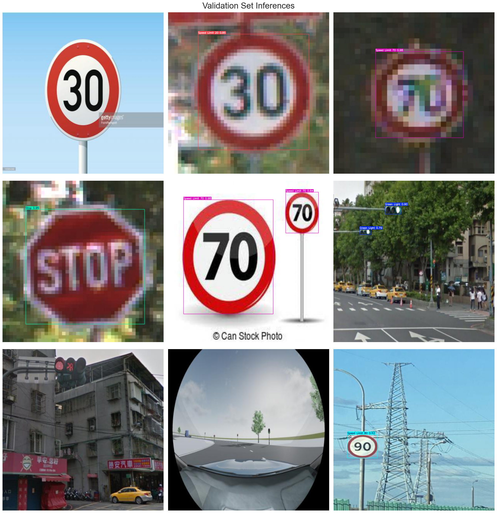
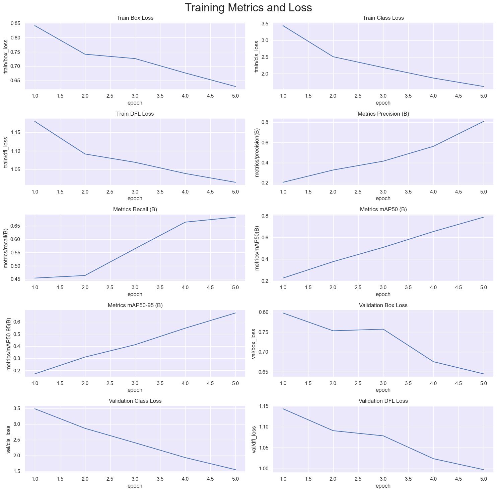
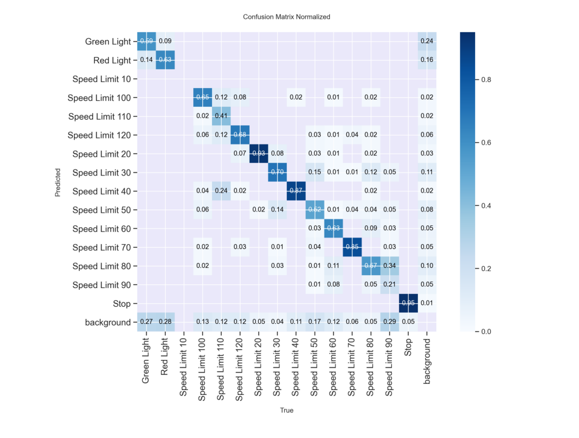

# 🚗 Autonomous Driving: Traffic Sign & Light Perception

> An end-to-end perception module for a self-driving car: a **YOLOv8 detector** recognizes **15 classes of traffic signs and traffic lights**, and a **temporal decision engine** turns the noisy per-frame detections into a **stable driving command** (STOP / PROCEED / CRUISE + active speed limit).


<p align="center">
  
  <br><em>Detections on unseen test images</em>
</p>

---

## ✨ Highlights

- 🎯 **mAP@50 = 0.787** and **precision = 0.81** on 801 validation images, after only 5 epochs of fine-tuning on a laptop CPU
- 🚦 **15 classes:** red / green traffic light, Stop, and 12 speed limits (10 → 120 km/h)
- 🧠 **Decision engine** with temporal confirmation, class-specific thresholds, priority rules and a latched mandatory stop
- 🎥 **Real-time video pipeline** with a HUD overlay (command, speed limit, FPS) for video files, webcams and image folders
- 🧪 **Unit-tested** decision logic (pytest), reproducible training from a YAML config, per-class evaluation reports

## 🏗️ Architecture

```
┌─────────────┐    ┌──────────────────────┐    ┌──────────────────────────────────────────┐    ┌──────────────┐
│ Camera /    │    │  YOLOv8 detector     │    │  Decision engine (traffic_ai/decision.py)│    │  Driving     │
│ video frame │──► │  15 classes          │──► │  1. confidence + size filtering          │──► │  command     │
│             │    │  boxes + confidences │    │  2. temporal confirmation (k of N frames)│    │  + speed     │
└─────────────┘    └──────────────────────┘    │  3. priority state machine               │    │  limit + HUD │
                                               │  4. speed-limit memory, stop latch       │    └──────────────┘
                                               └──────────────────────────────────────────┘
```

### Why a decision engine?

A detector works frame by frame: a sign can be detected in one frame, missed in the next, or confused with a similar sign for a single frame. A car that reacted to every raw detection would brake and accelerate erratically. The engine adds the reasoning a real driver uses:

| Mechanism | What it does | Why |
|---|---|---|
| **Asymmetric thresholds** | Red light 0.30, Stop 0.35, Green light 0.50 | Missing a red light is much worse than braking for a false one |
| **Size filter** | Ignores boxes smaller than 0.04% of the frame | Far-away signs are not relevant yet and are often misread |
| **Temporal confirmation** | A class must appear in ≥ 3 of the last 8 frames | Removes single-frame false positives and tolerates short misses |
| **Priority rules** | Red light > Stop > Green light > Cruise | Safety first; red **and** green at once → STOP |
| **Latched stop** | Holds STOP ~1 s after a Stop sign, then releases even if the sign is still in view | Full stop, without getting stuck in front of the sign |
| **Speed-limit memory** | Keeps the last confirmed limit after the sign leaves the frame; on a tie takes the lower one | Speed limits apply until the next sign |

```python
from traffic_ai.decision import DecisionEngine, Detection

engine = DecisionEngine()
sign = Detection("Speed Limit 50", confidence=0.91, box=(410, 120, 470, 180))

for _ in range(3):                      # the sign must be seen in 3 frames to be trusted
    decision = engine.update([sign], frame_size=(1280, 720))

print(decision)   # CRUISE   | limit 50 km/h  | keeping speed limit 50 km/h
```

## 📊 Results

**YOLOv8n (3M parameters) fine-tuned for 5 epochs on CPU. Validation set: 801 images / 944 objects.**

| Metric | Value |
|---|---|
| Precision | **0.808** |
| Recall | **0.683** |
| mAP@50 | **0.787** |
| mAP@50-95 | **0.672** |

<details>
<summary><b>Per-class results</b></summary>

| Class | Precision | Recall | mAP@50 |
|---|---|---|---|
| Stop | 0.987 | 0.913 | 0.991 |
| Speed Limit 20 | 0.834 | 0.893 | 0.952 |
| Speed Limit 70 | 0.885 | 0.872 | 0.938 |
| Speed Limit 40 | 0.868 | 0.891 | 0.919 |
| Speed Limit 120 | 0.789 | 0.750 | 0.871 |
| Speed Limit 100 | 0.887 | 0.605 | 0.826 |
| Speed Limit 30 | 0.784 | 0.757 | 0.819 |
| Speed Limit 110 | 1.000 | 0.572 | 0.799 |
| Speed Limit 60 | 0.842 | 0.618 | 0.791 |
| Speed Limit 80 | 0.582 | 0.714 | 0.741 |
| Speed Limit 50 | 0.777 | 0.606 | 0.708 |
| Green Light | 0.733 | 0.639 | 0.642 |
| Red Light | 0.698 | 0.546 | 0.628 |
| Speed Limit 90 | 0.652 | 0.184 | 0.389 |

</details>

<p align="center">
  
  
</p>

**Analysis**
- **Stop signs** are almost perfect (mAP@50 0.99) thanks to their unique octagonal shape.
- **Traffic lights** are the hardest: small objects in cluttered urban scenes. This is why the decision engine uses a lower threshold for red lights plus temporal confirmation.
- **Speed Limit 90** is the weakest class (recall 0.18): it has the fewest samples (38) and is visually close to 80 and 60.
- Every metric was **still rising at epoch 5**. The new training config (`configs/train.yaml`) runs 50 epochs with early stopping, a cosine LR schedule and sign-specific augmentation (see below).

## 🧪 Training setup

`configs/train.yaml` is tuned for traffic signs:

- **No horizontal flip:** a mirrored "70" is not a valid sign and would teach the model wrong digits
- **Small rotations (±5°), scale jitter and brightness/saturation changes** for distance, tilt and lighting (day, dusk, shadows)
- **No mixup:** blending images would mix red and green lights
- **Early stopping** (patience 15), **cosine LR**, mosaic turned off for the last 10 epochs, fixed seed for reproducibility

## 📁 Project structure

```
Autonomous-Driving/
├── traffic_ai/
│   ├── config.py        # class names, defaults, device auto-selection, seeding
│   ├── train.py         # CLI: fine-tune YOLOv8 from a YAML config
│   ├── evaluate.py      # CLI: metrics + per-class CSV / Markdown report
│   ├── predict.py       # CLI: video / webcam / images → annotated output + HUD
│   └── decision.py      # temporal decision engine (pure Python, no ML dependencies)
├── configs/
│   ├── train.yaml       # hyperparameters & augmentation
│   └── data.example.yaml
├── notebooks/
│   └── 01_yolov8_traffic_signs.ipynb   # exploration, training run and plots
├── tests/
│   └── test_decision.py
├── assets/              # figures used in this README
└── video.avi            # sample driving video
```

## ▶️ Quick start

```bash
pip install -r requirements.txt

# 1. dataset: copy the template and set `path` to your dataset folder
cp configs/data.example.yaml configs/data.yaml

# 2. train
python -m traffic_ai.train --data configs/data.yaml

# 3. evaluate (per-class report in runs/eval/)
python -m traffic_ai.evaluate --weights runs/traffic_signs/weights/best.pt --data configs/data.yaml --split test

# 4. run on the sample video (annotated video in runs/predict/)
python -m traffic_ai.predict --weights runs/traffic_signs/weights/best.pt --source video.avi --show

# tests
pytest
```

`predict` logs only **changes of state**, not every frame. The log format looks like this:

```
[frame <n>] CRUISE   | limit -        | no traffic control detected
[frame <n>] PROCEED  | limit -        | green light
[frame <n>] STOP     | limit -        | red light
```

At the end it prints a summary: average FPS and the share of frames spent in each state.

## 🗂️ Dataset

- Traffic signs and traffic lights in **YOLO format** (`class x_center y_center width height`, normalized to [0, 1])
- 416×416 images; **~3.5k train** and **801 validation** images, plus a held-out test split
- Not included in the repository because of its size: point `configs/data.yaml` to your local copy

## 🔮 Roadmap

- [ ] Train 50+ epochs on a GPU; compare YOLOv8n / s / m (accuracy vs FPS)
- [ ] Oversample rare classes (Speed Limit 90, 110)
- [ ] Multi-object tracking (ByteTrack) so the engine can reason per sign instead of per class
- [ ] Export to ONNX / TensorRT and deploy on a Raspberry Pi robot car

---

<sub>University project for the <b>SBC</b> course · built with PyTorch, Ultralytics & OpenCV · author: Goga Alex-Andrei</sub>
